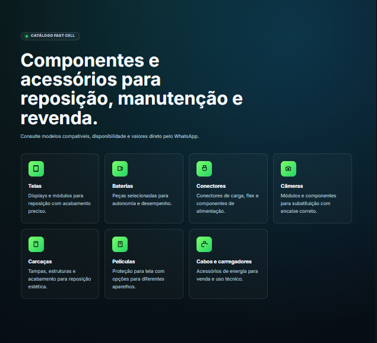
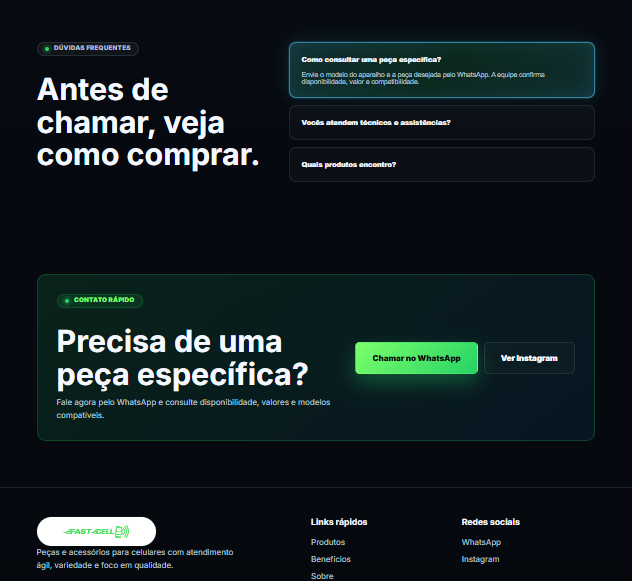

# Fast Cell — landing page comercial

Landing page responsiva para apresentar peças e acessórios de celular e levar o visitante ao atendimento da Fast Cell no WhatsApp. Projeto estático, feito com HTML, CSS e JavaScript, sem dependências de produção.

**[Ver a página publicada](https://fastcell.netlify.app/)** · **[Ver o código](https://github.com/CorreaVictorHugo/Landing_Page_Fast_Cell)**

## O projeto

O fluxo foi pensado para técnicos, assistências e clientes que precisam consultar uma peça: entender o catálogo, conferir como funciona a compra e iniciar uma conversa. A página reúne categorias de produtos, benefícios, perguntas frequentes e chamadas para contato.

### Prévia

| Abertura | Catálogo | Contato |
| --- | --- | --- |
|  |  |  |

## Decisões de implementação

- **Contato direto:** as chamadas principais abrem o WhatsApp da loja, sem formulário intermediário.
- **Layout responsivo:** navegação e grades se adaptam a telas menores.
- **Acessibilidade:** link para pular ao conteúdo, foco visível, menu com estado anunciado e perguntas frequentes com `details`/`summary` nativos.
- **Resiliência:** conteúdo e perguntas frequentes continuam acessíveis sem JavaScript; animações respeitam a preferência por movimento reduzido.
- **Desempenho:** imagem principal em WebP com prioridade de carregamento e imagem secundária carregada sob demanda.

## Executar localmente

Clone o repositório e sirva a pasta com qualquer servidor HTTP estático:

```bash
git clone https://github.com/CorreaVictorHugo/Landing_Page_Fast_Cell.git
cd Landing_Page_Fast_Cell
python -m http.server 4187
```

Abra [http://localhost:4187](http://localhost:4187). Também é possível abrir `index.html` diretamente no navegador.

## Estrutura

```text
├── index.html       # Conteúdo e estrutura da página
├── styles.css       # Estilos e pontos de adaptação
├── script.js        # Menu, navegação e animações opcionais
└── assets/          # Imagens usadas no site e nesta documentação
```

## Publicação e personalização

Não há etapa de build. Em uma hospedagem estática como Netlify, use `main` como branch e `.` como diretório de publicação. Os links comerciais da Fast Cell estão em `index.html`; atualize-os antes de adaptar o projeto para outra empresa. Textos sobre estoque, preços e atendimento devem ser confirmados com o cliente antes da publicação.

## Autoria

Desenvolvido por **Victor Hugo** como projeto de portfólio de landing page comercial.
